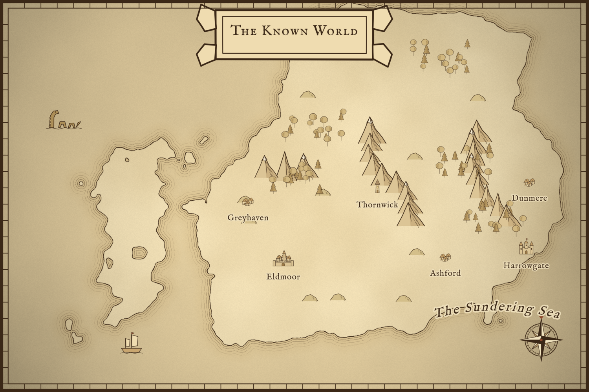

# Pocket-Mapp-Creator

A desktop map maker in the spirit of Inkarnate, for Windows, Linux and macOS (Electron).
Make Tolkien-style parchment world maps, towns and villages, and top-down RPG battle maps, then export them as PNG or JPG.



## Features

**Map styles** (switch at any time from the toolbar; the whole map re-skins)
- **Parchment** — sepia ink on aged paper, hatched mountains, Tolkien-style ripple lines around every coast
- **Full colour** — saturated, game-ready, beaches and shallow water
- **Watercolour** — soft washes with bleeding edges and pigment rims

**Map types**
- **World / Region** — paint continents and seas; side-view mountains, forests, castles, cities
- **Town / City / Village** — 3/4-view houses, taverns, chapels, windmills, walls, gatehouses
- **Battle maps** — top-down trees, rocks, furniture, campfires, with a square or hex grid (default 70 px cells)

**Asset genres:** Fantasy, Sci-Fi, Modern, Realistic — 107 original assets × 3 styles.

**Editing**
- Adjustable map size (presets or custom up to 8000 × 8000) — resize later by extending/cropping or by scaling everything
- Every asset can be moved, **rotated** (handle, R key, or slider) and **scaled** (corner handles, [ ] keys, or slider), flipped, layered, faded
- **Scatter brush** to paint whole forests or mountain ranges with random size, rotation and flip
- **Land brush** (add land / add water) with automatic inked coastlines; **Ground brush** for roads, dirt and clearings
- **Line tool** for tapering rivers, dashed roads, dotted trails, dash-dot borders and walls
- **Text labels** with 8 bundled map fonts, halo, letter-spacing, CAPS, and **curved text**
- **Assets used** panel — every asset type on the map with its count; select all copies, hide them, or delete all copies in one click; expand to jump to individual copies
- Import your own PNG/SVG assets (saved inside the map file)
- Undo/redo, save/open `.mapp` files, export **PNG** or **JPG** at 0.5×–2× resolution

## Running it

Requires Node.js 18+.

```bash
npm install
npm start
```

## Building an installer

```bash
npm run dist:win     # Windows installer + portable .exe (run on Windows)
npm run dist:linux   # AppImage + .deb
npm run dist         # current platform
```

Output goes to `dist/`.

## Regenerating the asset library

All built-in assets are drawn by code in `tools/generate-assets.js`. Edit a palette or a drawing function, then:

```bash
npm run assets
```

## Shortcuts

| Key | Action |
|---|---|
| V S B P L T H | Select · Stamp · Land · Ground · Lines · Text · Pan |
| Space + drag / middle mouse | Pan |
| Wheel | Zoom |
| Ctrl+Z / Ctrl+Y | Undo / Redo |
| Ctrl+D, Alt+drag | Duplicate |
| Delete | Delete selection |
| R / Shift+R | Rotate ±15° (Shift while dragging the handle snaps to 15°) |
| F | Flip |
| [ / ] | Brush size, or scale the selection |
| Alt while painting | Erase / paint water |

## Licences

- Code: MIT — see `LICENSE`
- Product icon: © MJO-Art (workmjo@gmail.com), all rights reserved — may not be altered or used without the Artist's express permission
- Built-in assets: original work, CC0 1.0 — see `ASSET-LICENSES.md` (full per-asset list)
- Fonts: SIL Open Font License 1.1 — see `ASSET-LICENSES.md` and `src/fonts/licenses/`

© 2026 project-tech-me · project-tech-me@protonmail.com
